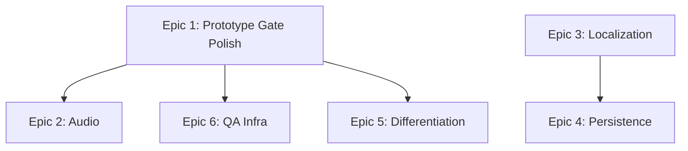

# Production Epics — Othello (Godot 4.7.2)

**Project State:** pre-production | **Vertical Slice:** PROCEED (90 checks, 0 failures) | **Prototype Gate (m2):** **PROCEED** — see `production/session-state/prototype-gate-check.md` | **Baseline:** Playable Othello loop vs AI / local PvP, all P0/P1 systems asserted.

---

## Epic 1: Prototype Gate Polish & Hardening
**Outcome:** Ship a prototype that passes the "prototype gate" — rule-faithful, readable, instantly restartable, with measured AI performance and baseline accessibility.

**Status:** ✅ **DONE — gate PROCEED 2026-10-19** (12/12 criteria; see `production/session-state/prototype-gate-check.md`)

**Dependencies:** None (starts from current vertical slice).

**Risks:**
- Hard-difficulty search time may exceed feel budget on weak hardware. → **Measured: 403ms median, PASS**
- Feedback cadence (0.5s/0.8s/1.0s) may feel too fast/slow in playtest. → **Recorded, no change**
- Cell child-index coupling (C9) blocks any future cell art. → **Resolved: named refs + Control-based cells**

**Validation Gate:**
- ✅ Hard depth-5 search completes in ≤ 500ms on reference hardware (measuring script).
- ✅ S8-VT-1..4 visual pass recorded (qa-playtester).
- ✅ Cell children refactored to named references (no `get_child(0/1)` in visuals code).
- ✅ Keyboard-only playthrough completes one match (S14 baseline).
- ✅ Contrast ratio ≥ 4.5:1 for text / ≥ 3:1 for UI (measured, asserted by S14-AT-1/2).

---

## Epic 2: Audio Foundation (S12)
**Outcome:** Disc-place, flip, invalid-move, win/lose, and UI sounds play correctly and respect a basic volume setting.

**Dependencies:** Epic 1 (cell refactor makes adding VFX/audio hooks clean).

**Risks:**
- No audio pipeline exists; asset format/import settings undefined.
- Sound timing must not block the turn flow.

**Validation Gate:**
- 5 WAV/OGG assets imported and triggered at the correct moments (disc place, flip, invalid, game-over, button click).
- Master volume slider in settings bar works and persists in-session.
- No audio latency > 50ms on headless run (spot-check).

---

## Epic 3: Localization Foundation (S13)
**Outcome:** All player-facing strings externalized; English locale loads; adding a new locale requires only a CSV/JSON file.

**Dependencies:** None (can run in parallel with Epic 1).

**Risks:**
- 20+ hardcoded strings across `othello.gd` (status, labels, button text).
- Pluralization not needed for Othello, but infra should support it.

**Validation Gate:**
- `strings.csv` (or `translation.tscn`) loaded via Godot `TranslationServer`.
- Switching locale at runtime updates all labels without restart.
- English file reviewed for tone/consistency; no string exceeds 2× English length in UI.

---

## Epic 4: Persistence / Save Game (S11)
**Outcome:** A match in progress (board, turn, mode, difficulty, scores) can be saved to disk and resumed on next launch.

**Dependencies:** Epic 3 (save format should be locale-agnostic JSON).

**Risks:**
- Save schema must version forward-compatibly (add fields, never remove).
- Restore must re-apply legal-move highlights and correct turn prompt.

**Validation Gate:**
- `user://save.json` written on quit and on explicit "Save" (future UI).
- Cold boot → load → board identical, turn correct, hints correct, game-over state preserved.
- Corrupted/missing save falls back to `_new_game()` cleanly.

---

## Epic 5: Differentiation Exploration (Post-Gate)
**Outcome:** A documented product-differentiation hypothesis with a throwaway prototype spike, ready for go/no-go at the prototype gate.

**Status:** ✅ **DONE 2026-10-19 — spike executed, decision: KILL (as designed)** (see `production/spike-intent-report.md`; implementation archived on branch `spike/intent`, not merged)

**Dependencies:** Epic 1 (gate must pass first).

**Risks:**
- Scope creep: differentiation is explicitly a Non-Goal for the prototype. → **Contained: spike ran on an isolated branch; main unchanged**
- Must not disturb the verified P0/P1 loop. → **Verified: all 96 pre-existing assertions passed on the spike branch (105 total)**

**Validation Gate:**
- ✅ One-page hypothesis doc: fantasy, mechanic, audience, risk (`design/differentiation-hypothesis.md`).
- ✅ Throwaway spike (separate branch, ≤ 2 days) proves the mechanic is fun or kills it. → **Killed it**
- ✅ Decision recorded: PROCEED to production with differentiation / KILL differentiation / PIVOT core loop. → **KILL**

**Carried forward:** the need is real (players must read the AI) but the answer is *legibility*, not a timed guessing game. Test AI opacity in the PT-2/PT-3 human sessions; if confirmed, prototype surfacing the AI's reason.

---

## Epic 6: QA & Playtest Infrastructure
**Outcome:** Repeatable, evidence-backed playtest sessions and regression coverage for every P0/P1 system.

**Status:** 🟡 **PARTIAL** — test runner, CI, QA plan, and session instrumentation are done; the 3 human playtest sessions are not

**Dependencies:** Epic 1 (needs stable build to test against).

**Risks:**
- Current harness is out-of-tree; in-tree visual/UX issues invisible. → **Addressed: GUT suite runs the same 96 assertions; live-game error checking via Godot MCP**
- No device matrix or platform test plan. → **Addressed: `production/qa-plan.md`**

**Validation Gate:**
- ✅ `test-setup` workflow rendered and passing (Godot test runner + headless CI). → GUT 9.6.1 + `.github/workflows/ci.yml`
- ✅ `qa-plan` authored: 5 playtest scenarios, device list, regression checklist, bug triage SLA. → `production/qa-plan.md`
- ⬜ At least 3 recorded playtest sessions (internal) with debrief notes. → **1 of 3 DONE (session 1 PASS: 3/3 matches, 0 bugs, 2.2% invalid-click rate). Sessions 2 & 3 scheduled — see `production/stories-sprint4.md` STORY-4.4**
- ✅ CI runs harness on every push; exit non-zero on failure.

---

## Dependency Graph

**Critical Path:** Epic 1 → Epic 6 (gate → validated build).  
**Parallelizable:** Epics 2, 3, 4 can start once Epic 1 delivers the cell refactor (for Audio) or independently (Localization, Persistence).

---

## Owner Assignments (Proposed)

| Epic | Primary Owner | Supporting |
|------|---------------|------------|
| 1. Polish & Hardening | producer + gameplay-programmer | qa-playtester, accessibility-specialist |
| 2. Audio | sound-designer | ui-programmer, technical-artist |
| 3. Localization | narrative-designer | ui-programmer |
| 4. Persistence | gameplay-programmer | systems-designer |
| 5. Differentiation | senior-game-designer | producer, market-analyst |
| 6. QA Infra | qa-playtester | producer, godot-specialist |

---

## Timeline Target (from `production/timeline.md`)

- **m1: Playable prototype (Week 4)** — already achieved (vertical slice PROCEED).
- **m2: Prototype Gate (Week 6)** — Epic 1 + Epic 6 complete; gate review.
- **m3: Differentiation Decision (Week 8)** — Epic 5 spike complete.
- **m4: Content Complete (Week 12)** — Epics 2, 3, 4 complete; full P1 feature set.

---

## Risk Register (Carried from Active Session)

| ID | Risk | Likelihood | Impact | Epic | Mitigation |
|----|------|------------|--------|------|------------|
| R1 | Hard depth-5 > 500ms | Medium | Medium | 1 | Benchmark; cap depth or add time budget |
| R2 | Feedback cadence feels off | Medium | Low | 1 | S8-VT visual pass; adjust constants |
| R3 | C9 cell coupling blocks art | Medium | Medium | 1 | Refactor to named refs before Epic 2 |
| R4 | Accessibility gaps (contrast, keyboard) | Medium | Medium | 1 | S14 baseline pass in Epic 1 |
| R5 | AI strength unvalidated | Low | Low | 1 | Playtest at each difficulty |
| R6 | Audio pipeline undefined | Medium | Medium | 2 | Define import settings early |
| R7 | Save schema migration | Low | High | 4 | Version field from day 1 |

---

## Acceptance Signals Summary

| Epic | Must-Have Evidence |
|------|-------------------|
| 1 | Hard timing ≤ 500ms, S8-VT 1-4 pass, C9 refactored, keyboard match complete, contrast ≥ 4.5:1 |
| 2 | 5 sounds triggered correctly, volume slider works |
| 3 | Locale switch at runtime, all strings externalized |
| 4 | Save/load round-trip preserves full match state |
| 5 | Hypothesis doc + spike result + recorded decision |
| 6 | CI green, qa-plan authored, 3 playtest debriefs |

---

## Next Workflow

**`create-stories`** — break each epic into 1-2 day stories with acceptance criteria, owner, and verification.

**Immediate Action:** Producer prioritizes Epic 1 stories (Hard benchmark, C9 refactor, S8 visual pass, S14 baseline) for the first sprint.